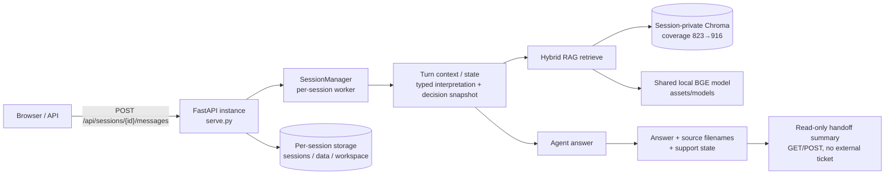

# 扫地机器人售后信息问答客服

一个本地可运行的扫地/扫拖机器人售后知识问答产品。范围是 `assets/knowledge/` 里的 6 份通用资料，覆盖选购、使用、保养、故障排查和回充；回答先检索、带来源文件名，资料不足时先追问。回充主线按会话保存当前问题、已试/未试步骤、下一步、来源作用域和结案状态，并支持更正撤回、重启恢复和只读转人工摘要。

> **Release v1（2026-11-15）** 最终产物 `robot_vacuum-v4-24f3a3db39`，本地交付配置 `outputs/release-v1/instance-8902.json`（端口 8902）。该配置、产物和运行会话都在本地，**不随 GitHub 仓库发布**；克隆后请按下方步骤用本地资产重建。最新 Demo 验收见 [docs/demo-acceptance.md](docs/demo-acceptance.md)，交付范围见 [docs/standalone.md](docs/standalone.md)。

> **Runtime/场景重构（2026-11-18）** 最终完整 artifact `robot_vacuum-v4-532c735eec` 已在隔离端口 18082 通过正常 HTTP/SSE 整产品验证。native 识别收紧为 exact 单 `react_loop` + 默认 `stop_when=no_tool_calls`；`answer_has_citation` 继续走 workflow，`FrameworkAgent` 仍是唯一装配点。契约、差异消除和实测见 [docs/runtime-refactor.md](docs/runtime-refactor.md)。该 artifact、配置和证据在本地，不入库。

## 快速开始（克隆后）

仓库只发布代码、文档、测试和小型 case 数据。6 份知识原文、本地 embedding 模型和 Chroma 索引因体积或再分发授权原因不入库，需要先从可信本地备份恢复到 `assets/`：

```text
assets/knowledge/             # 6 份扫地/扫拖资料（txt/pdf）
assets/models/bge-small-zh-v1.5/
assets/rag_index/             # collection=agent，512 维，823 条源向量
```

文件清单与校验值见 [assets/knowledge/README.md](assets/knowledge/README.md)、[assets/models/README.md](assets/models/README.md)、[assets/rag_index/README.md](assets/rag_index/README.md)。恢复说明和发布边界见 [docs/standalone.md](docs/standalone.md)。

### 1. 安装依赖

需要 Python 3.10+。推荐独立虚拟环境：

```powershell
python -m venv .venv
.\.venv\Scripts\Activate.ps1
pip install -r requirements.txt
```

> 2026-11-17 的干净 clone 验收**复用了已有 conda `langchain` 环境**，没有做全新 `pip install`；因此“依赖清单可安装”与“本次已全新安装”是两件事。干净 clone 中实际验证的是：复制本地资产 → 用已有环境构建 → `run.py --check` → 启动到隔离端口并就绪。

### 2. 准备模型密钥（仓库外）

密钥只放在仓库外的显式环境文件中，不要写进仓库、artifact 或实例配置：

```powershell
Copy-Item .env.example ..\local-secrets\robot-vacuum.env
# 编辑 ..\local-secrets\robot-vacuum.env，填入 DEEPSEEK_API_KEY
```

### 3. 构建独立产物

在仓库根目录执行：

```powershell
python -c "import sys; sys.path.insert(0, 'runtime'); from modules.artifacts.project import build_project; import json; print(json.dumps(build_project('.', '..\robot-vacuum-support-built', include_assets=True), ensure_ascii=False, indent=2))"
```

构建会在外部目录生成 `<name>-v<version>-<id>/` 和同名 `.zip`，并校验 manifest、checksums、runtime hash 与 assets；不会覆盖已有产物。记下输出目录名，下文记为 `<artifact>`。

从任意外部 cwd 做离线完整性校验：

```powershell
python <artifact>\run.py --check
```

`--check` 只校验 manifest/checksums，不代表模型凭据和本地资产已就绪；以 `/api/health` 的 `ready` 和 `needs_configuration` 为准。

### 4. 创建实例配置并启动

复制 [instance.example.json](instance.example.json) 到仓库外，改成绝对路径：

```json
{
  "schema_version": 1,
  "instance_id": "robot-vacuum-demo",
  "artifact_id": "<artifact 目录名>",
  "artifact_root": "<artifact 的绝对路径>",
  "name": "扫地机器人售后客服",
  "scenario": "robot_vacuum",
  "version": 4,
  "workflow": "agent",
  "host": "127.0.0.1",
  "port": 8902,
  "storage_root": "<仓库外可写目录>",
  "environment_file": "<仓库外 .env 绝对路径>",
  "asset_bindings": {}
}
```

隐藏窗口启动，不要打开可见控制台：

```powershell
Start-Process -FilePath python `
  -ArgumentList @("<artifact>\serve.py", "--instance-config", "<instance.json>") `
  -WindowStyle Hidden
```

确认就绪：

```powershell
Invoke-RestMethod http://127.0.0.1:8902/api/health
Invoke-RestMethod http://127.0.0.1:8902/api/instance
```

产品地址是 `http://127.0.0.1:8902/`；健康/身份接口是 `GET /api/health`、`GET /api/health/live`、`GET /api/health/ready`、`GET /api/instance`；`/api` 与 `/api/v1` 双路由保持兼容，OpenAPI 在 `/api/docs`。每个会话使用独立的 `data/`、`workspace/chroma_db` 和会话存储；`assets/models` 只读共享。启动时会把知识复制到会话数据目录、把索引复制到会话 workspace，并在私有副本上做 PDF 编号条目 coverage。

> `scripts/manage_product.py` 只管理本机固定的 `outputs/release-v1/instance-8902.json` 和冻结产物，**不是克隆后的通用入口**；干净 clone 没有该配置。GitHub 访客请使用上面的显式 `serve.py --instance-config`。

## 人工后台（本机单人客服）

后台入口：`http://127.0.0.1:<port>/admin.html`（同实例，无新前端框架）。

工作流：前台点“申请人工处理”→ 后台“待处理”列表 → 接手 → 填写人工回复 → 用户前台轮询看到带“人工客服”标识的回复 → 填写结案备注并“结案并恢复机器人”。工单状态 `waiting / active / closed` 与会话 `active / ended` 独立；结案后用户可重新申请，生成新工单并保留旧工单摘要。打开工单期间，用户新消息只进人工队列、不调用模型；重复申请幂等，人工回复用 `request_id` 防重复，机器人忙时申请返回 409。

后台只读取会话记录和现有只读转人工摘要，不上传知识原文。每个会话的工单持久化在 `handoff.json`，原子写 + 文件锁。认证分两种模式：

- **未配置 `RVS_ADMIN_TOKEN`（兼容本机模式）**：管理 API/页面仅当实例绑定 `127.0.0.1 / ::1 / localhost` 时开放，`0.0.0.0` 等远程绑定直接 403；不信任 `Host`/`Forwarded`。
- **配置 `RVS_ADMIN_TOKEN`（云/远程模式）**：管理 API 要求 `Authorization: Bearer <token>`，constant-time 比较；后台页面是公开登录壳，管理员在页面输入 token 后仅存 `sessionStorage`，不进 URL/localStorage，所有管理数据请求都带 Bearer。

管理写入始终要求 `application/json` 和允许的 `Origin`（本机无 `Origin` 的 API 调用允许）；跨域只认显式 `RVS_ALLOWED_ORIGINS` 白名单，同源反代可用。普通会话 API 在公开部署设置 `RVS_ACCESS_TOKEN` 后要求用户 Bearer/Cookie；这是**单租户共享门禁**，不是多用户隔离。页面文本全部按纯文本渲染。

## 云部署与前后端分离（Docker）

`Dockerfile`、`docker-compose.yml`、`.dockerignore`、`deploy/nginx.conf`、`docker/entrypoint.py` 和 `.env.docker.example` 提供单租户本地可部署交付：backend 为 Python 3.11 非 root、只在内部网络；nginx 是唯一公开端口并独立 serve `product_ui`；`RVS_SERVE_STATIC=false` 关闭 backend 静态托管。entrypoint 启动时复用现有 `build_project` 在可写 `/data` 构建 artifact，资产（知识/模型/索引）只读挂载，镜像不含它们和密钥/outputs。SSE 经 nginx 关闭 buffer/缓存并使用长超时。

完整步骤、token 生成（文档只放占位值）、资产挂载、CORS、日志/恢复和限制见 [docs/deployment.md](docs/deployment.md)。部署前可运行 `python scripts/docker_deploy.py preflight --env-file .env.docker`；隔离 smoke 用独立 project/端口/卷，脚本不打印 token。Windows 上连接已有无头 WSL2 Engine、不启动 Desktop/daemon 的做法、路径与命名隔离见 [docs/headless-migration.md](docs/headless-migration.md)。**注意是单租户**：`RVS_ACCESS_TOKEN` 是共享访问门禁，不提供按访客的会话所有权；公开部署必须设置它，管理 token 必须另设。没有云服务器凭据，因此交付的是本地可部署文件与本地验证结果，不声称线上已部署。

## Demo 与案例

- [Demo 台本：3 组引导场景（检索边界 / 更正 / 恢复交接）](docs/demo-walkthrough.md)
- [旧版 Demo 台本：6 个场景、停止条件、真实回答边界](docs/demo-prompts.md)
- [面试演示：两个 2 分钟真实失败案例](docs/interview-demo.md)
- [本次 Demo 验收（2026-11-17）](docs/demo-acceptance.md)
- [产品界面截图（headless Chrome，8902）](docs/images/demo-8902-headless-20261117.png)
- [PDF 检索修复：8→101 块与私有索引 coverage](docs/pdf-retrieval-fix.md)
- [两个优化回路的证据与边界](docs/optimization-loops.md)
- [三主线修复记录：401 传播 / embedding 路径 / fallback 更正撤回](docs/three-mainlines-fix-v1.md)
- [Runtime/场景重构：native 识别收紧、workflow 保留与最终整产品验证](docs/runtime-refactor.md)
- [Release v1 交付说明](docs/release-v1.md)

演示只核对功能是否出现和边界是否守住，不背固定答案。不要把结构检查写成成功率，也不要把本地摘要写成外部工单。

## 架构



关键取舍：动态事实（已试/未试、来源作用域、当前阶段、旧任务）放在 context/state，不逐条写进 system prompt；prompt 只保留稳定职责。检索来源只证明“本轮有该文件名”，不声称逐 claim 语义正确。

## 目录

```text
robot-vacuum-support/
  project.json                  # 工程声明（spec/runtime/frontend/assets）
  robot_vacuum/                 # 场景 spec，v1.json 为权威
  runtime/                      # 独立运行时源码（core + modules + config）
  product_ui/                   # 产品原生静态前端（config.js 配置 API 基址）
  scripts/manage_product.py     # 本机固定 8902 实例的启停包装（非通用入口）
  requirements.txt
  Dockerfile                    # Python 3.11 非 root backend
  docker-compose.yml            # backend + nginx frontend，单公开端口
  deploy/compose.headless.yml   # 无头/独立 project 的最小 override
  deploy/nginx.conf             # 静态前端 + /api 反代 + SSE 禁 buffer
  docker/                       # entrypoint（build_project -> serve）与健康探针
  scripts/headless_docker.py    # 固定 WSL distro/project 的无头包装
  assets/                       # knowledge/models/rag_index 本地提供，不入库
  docs/                         # 设计、契约、评测口径、Demo 与发布说明
  tests/
  README.md
```

## 配置

- `runtime/config/rag.yml`：`chat_provider`、`chat_model_name`、`embedding_provider: local`、`embedding_model_name: data/models/bge-small-zh-v1.5`、`retrieval_k`、`retrieval_mode: hybrid`。
- `runtime/config/chroma.yml`：`collection_name: agent`、`persist_directory: data/runtime/chroma_db`、`data_path: data/knowledge`。
- 这些 `data/...` 路径由实例的 `AH_DATA_ROOT` / `AH_RUNTIME_ROOT` / `AH_MODEL_ROOT` 投影到会话目录，不依赖原开发机绝对路径。
- 部署认证：`RVS_ADMIN_TOKEN`（管理 Bearer；未配置时仅 loopback 本机）、`RVS_ACCESS_TOKEN`（公开会话基础门禁；公开部署必须设置）、`RVS_ALLOWED_ORIGINS`（显式 CORS 白名单）、`RVS_SERVE_STATIC`（默认 true，容器示例为 false）。模板见 [.env.docker.example](.env.docker.example)。
- 换模型或换索引时保持 embedding 维度一致（当前 BGE small zh 为 512 维）；collection 仍为 `agent`。

## 编辑与重建

- 场景是 spec-owned：改 `robot_vacuum/v1.json`（或编辑器保存新版本），再运行构建命令；不要改 `state.json` 绕过守卫。
- 只登记 `rag_summarize` / `rag_retrieve`，没有设备控制、账号查询或个人报告工具。
- 改了 `runtime/` 或 `product_ui/` 后重新构建，改动会进入新产物；已有旧产物不覆盖。
- 回答要求：真实检索、方括号来源引用、资料不足先追问、只使用扫地/扫拖知识。

## 已知局限

- 没有正式 40–60 集、holdout、真实用户量、满意率或生产 SLA；Demo 和 12 案验收都不是成功率。
- 回充状态只覆盖回充单流程；其他主题走 transcript-only 摘要，不伪造故障状态。
- 引用检查主要是来源存在/被回传，不声称语义正确率或逐 claim 蕴含。
- PDF 修复只覆盖当前 6 份资料的编号结构；扫描版 PDF/OCR、无编号结构的 PDF 未覆盖。
- 转人工摘要只在本地整理，不生成外部工单；复制/下载不等于操作系统剪贴板审计。
- 云部署是单租户：访问 token 是共享门禁，不做多用户账号/会话所有权；持有同一 token 的访客可互看该实例会话。
- 没有云服务器/域名/证书凭据，未做真实线上部署或生产 SLA 验证；Docker 本地 build 受网络限制时如实记录为阻塞。
- 12 案结构验收的冻结预期未改；最终 artifact 本轮为 11 `passed_structural` / 1 `failed_structural`（`ml-recharge-normal-closure` 第二轮 `retrieval_attempted=false`）。此前同样失败过、本轮结构通过的 `ml-suction-correction-third-party` 不据此写成缺陷已修复；单次运行不是成功率。
- 本仓库不包含父工作区计划、构建产物、运行会话、人工审核原文和未授权资料；历史文档中的 `outputs/...` 链接表示本地证据位置。

## 测试

```powershell
python -m pytest tests/test_cloud_deployment.py tests/test_handoff_admin.py -q
python -m pytest tests/test_demo_readiness.py -q
python -m pytest tests/test_rag_ingestion_coverage.py tests/test_rotating_mainline_acceptance.py -q
```

测试与定向回归只证明被测试行为，不等于体验成功率或语义正确率。
